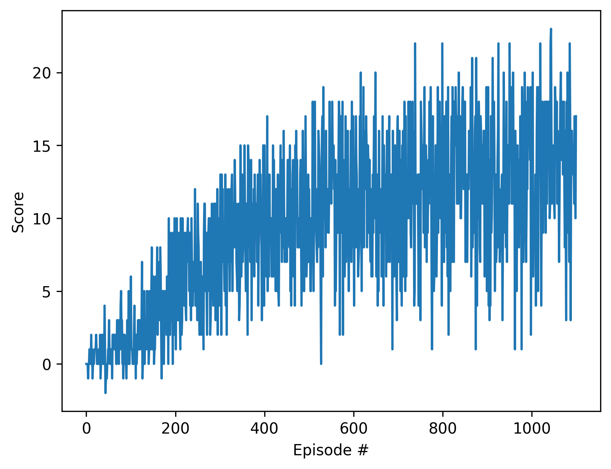

# Report — Banana Collector

## 1. Learning algorithm

The agent is implemented in Python 3 and PyTorch. It combines four DQN improvements:

1. Double DQN separates action selection from target evaluation.
2. A dueling network estimates a state-value stream and an action-advantage stream.
3. Prioritized experience replay emphasizes transitions with larger TD errors and uses importance weights to compensate for sampling bias.
4. Three-step returns propagate observed rewards over several transitions before bootstrapping.

This is not full Rainbow: Noisy Networks and distributional value learning are not implemented.

### Multi-step Double DQN target

A deque holds up to three consecutive transitions. For an entry with actual horizon k:

```text
R(k) = sum from j=0 to k-1 of gamma^j * r[t+j+1]
a*   = argmax_a Q_online(s[t+k], a)
y    = R(k)                                  if done
y    = R(k) + gamma^k Q_target(s[t+k], a*)     otherwise
```

The state and action come from the oldest transition; the endpoint observation and done flag come from the newest. Entries overlap. At episode end, shorter remaining entries are flushed before clearing the deque.

The legacy Unity done flag both ends the rollout and masks bootstrapping. The implementation does not distinguish external time-limit truncation from true termination.

### Prioritized replay and optimization

Experiences are stored in a 100,000-entry circular buffer. A sum tree stores leaf weights:

```text
priority_i = (abs(delta_i) + 1e-5)^0.6
P(i)       = priority_i / sum_j priority_j
w_i        = (N * P(i))^(-beta)
```

Sampling is stratified across cumulative priority mass. New entries receive the current maximum leaf weight. Importance weights are normalized by the largest weight over occupied entries. Beta increases linearly from 0.4 to 1 over five million training environment steps.

Learning starts when the buffer contains more than 64 entries and occurs every four training steps. Adam minimizes the minibatch mean of importance-weighted, unreduced squared TD errors. After each optimizer update, the target network is softly updated, then gradient-free TD errors refresh sampled priorities.

```text
theta_target <- 0.001*theta_online + 0.999*theta_target
```

Gradient clipping is not used.

## 2. Neural-network architecture

```text
Input: 37 numerical observations
    |
Linear(37, 128), ReLU
    |
    +-- Value head:     Linear(128, 128), ReLU, Linear(128, 1)
    |
    +-- Advantage head: Linear(128, 128), ReLU, Linear(128, 4)
    |
Q(s,a) = V(s) + A(s,a) - mean_a A(s,a)
```

There is no activation after aggregation. The output contains one Q-value per discrete action. The online and target networks share this architecture but have separate parameters.

## 3. Hyperparameters

| Hyperparameter | Value |
| --- | --- |
| Optimizer | Adam |
| Learning rate | 1e-4 |
| Replay capacity | 100,000 |
| Batch size | 64 |
| Discount factor | 0.99 |
| Soft-update coefficient | 0.001 |
| Optimizer-update frequency | Every 4 training environment steps |
| Replay threshold for learning | More than 64 entries |
| Multi-step horizon | 3, shortened at episode boundaries |
| Initial epsilon | 1.0 |
| Minimum epsilon | 0.01 |
| Epsilon decay | Multiply by 0.995 after each training episode |
| PER alpha | 0.6 |
| PER initial beta | 0.4 |
| PER final beta | 1.0 |
| Beta annealing duration | 5,000,000 training environment steps |
| Priority epsilon | 1e-5 |
| Agent seed | 0 |
| Diagnostic frequency | Every 300 training episodes |
| Diagnostic size | 20 episodes, greedy actions, no learning |
| Default episode budget | 2400, subject to early stopping |

Agent/network code seeds Python, PyTorch, and replay sampling. Unity's constructor does not explicitly specify a seed. This is a single-run result, not a multi-seed performance estimate.

## 4. Results and number of episodes to solve

The rubric's criterion is an average undiscounted reward of at least +13 over 100 consecutive episodes. The logged rolling training mean meets this criterion **by episode 1100**, with a value of **13.56**. This is the earliest qualifying checkpoint printed in the supplied log, not necessarily the exact first qualifying episode.


| Training episode | Mean score over last 100 training episodes | 
| --- | ---: | 
| 300 | 6.39 | 
| 600 | 11.47 | 
| 900 | 13.54 | 
| 1200 | 14.17 | 
| 1500 | 13.59 | 

With 300 training steps per episode, episode 1100 represents approximately 330,000 training interactions.

### Plot of rewards per episode — required submission asset

The following is the plot generated from the complete per-episode `scores` sequence. 



### Learning-rate experiment

An earlier run with learning rate 2.5e-4 reached an evaluation mean of 9.03 at episode 1200, declined afterward, and reached 12.19 at episode 6900. Reducing the rate to 1e-4 produced the stronger early learning curve documented above.

Smaller steps plausibly improved stability in this implementation; the comparison is observational rather than a controlled multi-seed study. 


## 5. Ideas for future work

1. **Measure generalization and variability.** Evaluate the saved policy over 100 greedy episodes and repeat training with several seeds, reporting undiscounted mean and standard deviation.
2. **Isolate algorithm contributions.** Compare against a uniform-replay Double DQN baseline, then add dueling, PER, and three-step returns separately.
3. **Improve stability.** Test Huber loss or gradient-norm clipping one at a time; both are experiments, not guaranteed improvements.
4. **Reduce replay overhead.** Replace full-buffer minimum and maximum priority scans with segment trees or maintained statistics.
5. **Improve experiment reproducibility.** Save optimizer, target-network, replay, counters, and random-generator states for resumable training.
6. **Explore remaining Rainbow components.** Study Noisy Networks for exploration and categorical distributional value learning as separate extensions.

## Implementation sources

- `dqn_agent_slow_lr.py`: agent, replay buffer, multi-step targets, optimization.
- `model.py`: dueling architecture.
- `p1_navigation_my_agent_slow_lr.ipynb`: training, diagnostics, saved results, learning curve, demonstration.

Environment and project specification: [Udacity Navigation](https://github.com/udacity/deep-reinforcement-learning/tree/master/p1_navigation).
